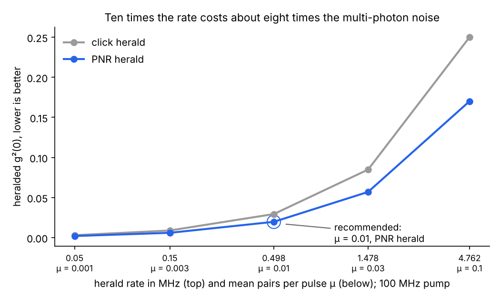

# Quantum Optics with QuTiP: from a single photon to an on-chip light source

A self-built course in quantum optics for integrated photonics, written while moving from classical photonics (Zemax, Lumerical) into quantum photonics. It runs from the first quantum state to a design study of a heralded single-photon source on a chip.

Every result is **validated**: each notebook compares its QuTiP simulations with analytic formulas through a `check()` helper and ends with a pass count, and notebook 09 compares the models with two published experiments.

**166 automated theory-vs-simulation checks, all passing.**

## Headline result

**[Quantum light source design](projects/quantum-light-source-design/design_report.md):** five source designs compared in QuTiP. A gently pumped microring (0.01 pairs per pulse) with a photon-number-resolving herald detector gives heralded g⁽²⁾(0) = 0.020, against 1.0 for an attenuated laser. Pump power trades rate for multi-photon noise almost one for one, and HOM visibility between two sources equals their spectral purity.



## Learning path

| # | Notebook | What it covers | Photonics link |
|---|---|---|---|
| 01 | [Quantum foundations](notebooks/01_quantum_foundations.ipynb) | States, Born rule, operators, eigenvalues, expectation values, Bloch sphere | Polarization: a quantum state is a Jones vector |
| 02 | [Single-photon and nonclassical states](notebooks/02_single_photon_states.ipynb) | Fock, coherent and squeezed states, g⁽²⁾(0), Mandel Q, Wigner function | Laser vs single-photon source vs squeezed light |
| 03 | [Gates and operations](notebooks/03_quantum_gates_operations.ipynb) | Unitarity, Hadamard, phase shifter, Mach–Zehnder, CNOT | Beam splitters, phase shifters, directional couplers |
| 04 | [Entanglement](notebooks/04_entanglement_multiparticle.ipynb) | Tensor products, Bell states, entanglement entropy | Entangled photon-pair sources |
| 05 | [Measurements and density matrices](notebooks/05_measurements_density_matrices.ipynb) | Mixed states, partial trace, loss, detector efficiency, tomography | Real chips lose light, real detectors miss photons |
| 06 | [Hong–Ou–Mandel effect](notebooks/06_hong_ou_mandel_effect.ipynb) | Two-photon interference, distinguishability, dip vs delay | The standard test of photon indistinguishability |
| 07 | [Photonic quantum circuits](notebooks/07_photonic_quantum_circuits.ipynb) | Chips as unitaries, permanents, boson sampling, teleportation | Programmable MZI meshes |
| 08 | [Quantum frequency combs](notebooks/08_quantum_frequency_combs.ipynb) | Four-wave mixing, two-mode squeezing, frequency-bin entanglement | Microring sources (Kues et al., Nature 2017) |
| 09 | [Validation against experiment](notebooks/09_validation_and_comparison.ipynb) | Theory vs simulation vs published data | Hong–Ou–Mandel 1987; Kues et al. 2017 |

**Project:** [quantum light source design](projects/quantum-light-source-design/) — [report](projects/quantum-light-source-design/design_report.md), [notebook](projects/quantum-light-source-design/simulations.ipynb), [script](projects/quantum-light-source-design/analysis.py).

Every concept is explained the same way: the idea in plain words with an optics analogy, the honest gap in that explanation, a one-sentence summary, and then code that checks the simulation against the analytic answer.

## Validation against published experiments

| Quantity | Model | Experiment | Verdict |
|---|---|---|---|
| HOM visibility, weak coherent light | 0.5 | limit quoted in the literature | agrees |
| Microring effective dimension (Kues et al.) | g⁽²⁾ = 1 + 1/K | 10.45 ± 0.53 | ideal K = 10 within 0.85 error bars |
| Qubit fidelity, D = 2 (Kues et al.) | 0.878 | 0.885 | agrees within 0.007 |
| Qudit fidelity, D = 4 (Kues et al.) | 0.873 | 0.766 | model too high: non-white imperfections not modelled |

## Run it

```bash
git clone https://github.com/<your-username>/qutip-quantum-optics-learning.git
cd qutip-quantum-optics-learning
pip install -r requirements.txt
jupyter lab
```

Every notebook runs top to bottom in seconds on a laptop (notebook 09 takes under a minute) and ends with `N of N checks passed`. Built and tested with Python 3, QuTiP 5.3.1.

## Limitations and next steps

- The light-source design uses assumed efficiencies (50 %) and a 100 MHz pump; the next step is to fit them to a published heralded-ring experiment.
- Dark counts, Raman noise and a continuous joint spectrum are not yet in the source model.
- Not yet covered: time evolution under a Hamiltonian, and g⁽²⁾(τ) as a function of delay.

## References

- C. K. Hong, Z. Y. Ou, L. Mandel, Phys. Rev. Lett. 59, 2044 (1987).
- M. Kues et al., "On-chip generation of high-dimensional entangled quantum states and their coherent control," Nature 546, 622 (2017).
- C. Reimer et al., Frontiers in Optics FTh3E.2 (2017).
- J. R. Johansson, P. D. Nation, F. Nori, QuTiP, [qutip.org](https://qutip.org).
