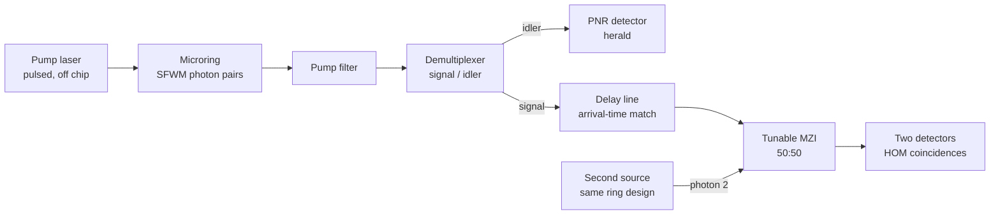

# Quantum Light Source Design Report

*Heralded single photons from an integrated microring: choosing the operating point and the herald detector.*

## Abstract

A heralded single-photon source built from a gently pumped integrated microring, with a photon-number-resolving (PNR) herald detector, gives the best quality per photon of the designs modelled: heralded g⁽²⁾(0) = 0.020 at about 0.5 MHz heralds, against 1.0 for an attenuated laser.

Five designs were modelled in QuTiP: an attenuated laser, and a heralded ring at two pump levels with either a click or a PNR detector. Each was scored on heralded g⁽²⁾(0), single- and multi-photon probability, herald rate and delivered single-photon rate. Every simulated quantity matched its analytic formula to four decimals. Pump strength trades rate for purity: raising the mean pair number μ from 0.01 to 0.1 raises the herald rate about tenfold and g⁽²⁾(0) about eightfold. HOM visibility between two independent sources equals their spectral purity, so purity, not brightness, limits multi-source circuits.

All efficiencies (50 %) and the 100 MHz repetition rate are assumed round numbers, not measured device data.

## 1. Introduction

Linear-optics quantum circuits need single photons that arrive when expected and that are identical across sources. Integrated microrings can supply both, because one pump field makes photon pairs by spontaneous four-wave mixing (SFWM) on a chip that also hosts filters and interferometers.

This project asks: which operating point and herald detector give the most useful single photons from a microring pair source? It builds on the frequency-comb work of Kues et al. (Nature 546, 622, 2017), where the same kind of ring produced frequency-bin entangled qudits. Here the ring is used as a heralded single-photon source, the first building block for HOM-based gates and boson sampling on chip.

## 2. Theory

**Pair state.** SFWM in one signal–idler resonance pair produces a two-mode squeezed vacuum

$$|\psi\rangle = \sqrt{1-x}\sum_{n=0}^{\infty} x^{n/2}\,|n\rangle_s|n\rangle_i,\qquad x = \tanh^2 r = \frac{\mu}{1+\mu}$$

where μ = sinh²r is the mean photon number per arm. Each arm alone is thermal (g⁽²⁾ = 2); the arms together are perfectly number-correlated.

**Heralding.** A detector on the idler with efficiency η_h fires with probability w_k for k idler photons:

- Click detector: w_k = 1 − (1 − η_h)^k
- PNR detector (exactly one count): w_k = k η_h (1 − η_h)^(k−1)

The heralded signal state is the partial trace of the pair state weighted by w_k. For a click herald the herald probability per pulse is

$$p_h = \frac{\eta_h\,\mu}{1+\eta_h\,\mu}$$

and, for small μ, g⁽²⁾(0) ≈ 2μ(2 − η_h). The PNR herald lowers this to about 4μ(1 − η_h).

**Loss.** Signal-arm loss η_s is a beam splitter with an empty mode, followed by a partial trace. It lowers the single-photon probability and the rate, but leaves g⁽²⁾(0) unchanged.

**Purity and HOM.** If the heralded photon is a mixture over Schmidt modes with weights λ_k, two independent identical sources give HOM visibility

$$V = \sum_k \lambda_k^2 = P = 1/K$$

where P is the spectral purity and K the Schmidt number.

## 3. Model and assumptions

The model ([`simulations.ipynb`](simulations.ipynb), same code as [`analysis.py`](analysis.py), QuTiP 5.3.1) is a truncated Fock-space simulation of one signal–idler mode pair, with heralding and loss applied as quantum operations rather than formulas.

| Parameter | Value | Status |
| --- | --- | --- |
| Photon-number cutoff per mode | 10 | Checked: output identical at cutoff 14 |
| Pump repetition rate | 100 MHz | Assumed |
| Herald-arm efficiency η_h | 0.5 | Assumed (filters, coupling, detector) |
| Signal-arm efficiency η_s | 0.5 | Assumed (delivery to the user) |
| Mean pairs per pulse μ | 0.001 to 0.1 | Swept |
| Spectral mode weight λ | 1.0 to 0.5 | Swept, two-mode model |

**Left out:** detector dark counts and dead time, Raman and fluorescence background, pump leakage through filters, spectral structure beyond two modes, timing jitter, and fabrication spread between two rings. Each lowers the quality figures, so the results are upper bounds for the stated efficiencies.

## 4. Validation

| Check | Simulation | Formula | Agreement |
| --- | --- | --- | --- |
| Herald probability, μ = 0.01 | 0.0050 | η_hμ/(1+η_hμ) = 0.0050 | exact |
| Herald probability, μ = 0.1 | 0.0476 | 0.0476 | exact |
| Heralded g⁽²⁾, click, μ = 0.01 | 0.0294 | exact series 0.0294 (approx. 0.030) | exact |
| Heralded g⁽²⁾, click, μ = 0.1 | 0.2500 | exact series 0.2500 (approx. 0.300) | exact |
| g⁽²⁾ before / after 50 % loss | 0.25 / 0.25 | unchanged by loss | exact |
| HOM visibility, λ = 0.9 | 0.82 | λ² + (1−λ)² = 0.82 | exact |

The small-μ approximation drifts by 20 % at μ = 0.1, so design numbers use the exact series.

**Against experiment** ([notebook 09](../../notebooks/09_validation_and_comparison.ipynb)): the same HOM model reproduces the 50 % visibility limit for weak coherent light and turns the 1987 Hong–Ou–Mandel dip width (about 100 fs) into a 6.24 THz photon bandwidth. For Kues et al. 2017, the multimode-thermal g⁽²⁾ = 1 + 1/K model is consistent with the reported effective dimension 10.45 ± 0.53. A white-noise model matched the measured D = 2 fidelity within 0.007 but over-predicted D = 3 and D = 4 by 0.07 and 0.11.

## 5. Results

| Design | Herald rate (MHz) | P(1) | P(≥2) | g⁽²⁾(0) | Single photons delivered (MHz) |
| --- | --- | --- | --- | --- | --- |
| D1 Attenuated laser, μ = 0.1 | none, times unknown | 0.048 | 0.0012 | 1.00 | 4.76 |
| D2 Ring, μ = 0.01, click herald | 0.50 | 0.500 | 0.0037 | 0.029 | 0.25 |
| D3 Ring, μ = 0.1, click herald | 4.76 | 0.498 | 0.037 | 0.25 | 2.37 |
| D4 Ring, μ = 0.1, PNR herald | 4.54 | 0.499 | 0.024 | 0.17 | 2.26 |
| **D5 Ring, μ = 0.01, PNR herald** | **0.50** | **0.500** | **0.0025** | **0.020** | **0.25** |

*η_h = η_s = 0.5, 100 MHz pump; P values are for the delivered signal, given a herald.*

The laser's 4.76 MHz of single photons is spread over pulses that are 95 % empty and never announced, so a circuit cannot time them. Among heralded designs, the PNR detector lowers g⁽²⁾(0) by a third at either pump level for under 5 % of the rate.

Both curves rise almost linearly with the rate, so there is no free operating point: μ is set by how much multi-photon noise the downstream circuit tolerates.

**Purity sets two-source HOM visibility.** For a heralded photon in two spectral modes with weights λ and 1−λ, the simulated HOM visibility equals the purity: λ = 1.0, 0.95, 0.9, 0.5 give 1.00, 0.905, 0.82, 0.50 (K = 1, 1.105, 1.22, 2). A 10 % admixture of a second spectral mode costs 18 % of the HOM visibility.

## 6. Proposed integrated circuit

Two identical rings feed a tunable Mach–Zehnder interferometer, so purity can be measured on the same device that will use the photons.

Coincidences are counted only when both heralds fire. The MZI phase sets the splitting ratio (P(1,1) = cos²φ, notebook 07), so the same structure first checks the 50:50 point and then measures the HOM dip that reports spectral purity.

## 7. Recommendation and limitations

**Build D5:** μ ≈ 0.01 pairs per pulse with a PNR herald, then spend effort on spectral purity and signal-arm loss rather than brightness. Its rate can be raised later by multiplexing several rings or time bins, which adds photons without adding multi-photon noise; raising μ cannot do that.

Improvements in order of payoff:

1. **Spectral purity.** HOM visibility between two sources equals purity, so a 0.9 mode weight already caps it at 0.82.
2. **Signal-arm efficiency η_s.** It sets the delivered rate and P(1) directly; g⁽²⁾(0) does not reveal it.
3. **Herald-arm efficiency η_h.** Higher η_h raises the herald rate and, with a PNR detector, suppresses multi-pair heralds further.

**Limitations.** Efficiencies and repetition rate are assumed, not measured. Dark counts, Raman background and pump leakage are absent, so real g⁽²⁾(0) values will be higher. The purity model uses two spectral modes, while a real ring's joint spectrum has a continuum. The model has not yet been compared with measured data from a heralded ring source; that is the first next step.

## References

- C. K. Hong, Z. Y. Ou, L. Mandel, "Measurement of subpicosecond time intervals between two photons by interference," Phys. Rev. Lett. 59, 2044 (1987). [record](https://scholars.cityu.edu.hk/en/publications/measurement-of-subpicosecond-time-intervals-between-two-photons-b/)
- M. Kues et al., "On-chip generation of high-dimensional entangled quantum states and their coherent control," Nature 546, 622 (2017). [record](https://iris.unipa.it/handle/10447/238845)
- C. Reimer et al., "Integrated generation of high-dimensional entangled photon states and their coherent control," Frontiers in Optics, FTh3E.2 (2017); source of the D = 2–4 visibilities and fidelities. [pdf](https://eprints.gla.ac.uk/155151/1/155151.pdf)
- Hong–Ou–Mandel effect overview, including the 50 % limit for weak coherent states. [laussy.org](https://laussy.org/HOM)
- QuTiP documentation. [qutip.org](https://qutip.org)
